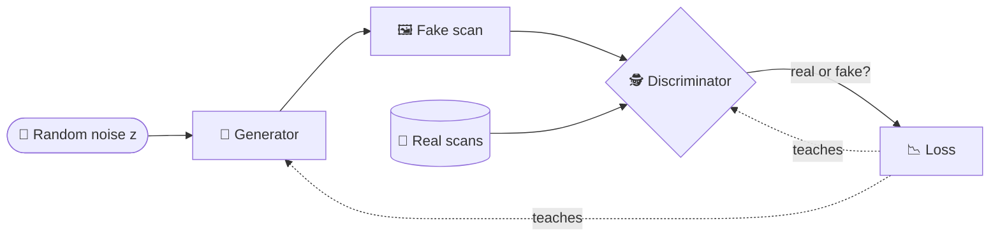
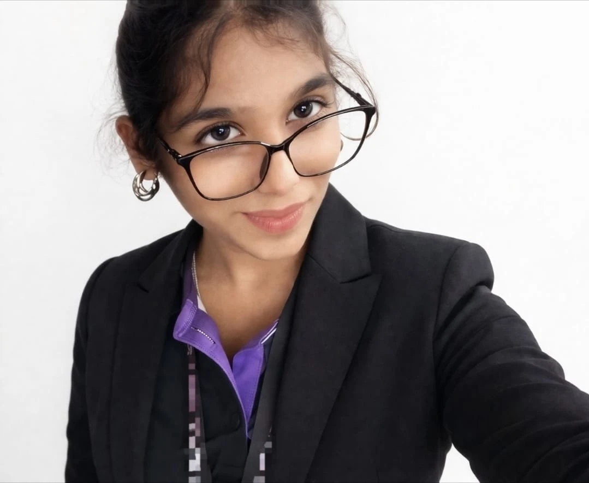

<div align="center">



### Free, in-browser tools for medical images, built on the ideas behind Generative Adversarial Networks

<p>
  
  
  
  
  
</p>
<p>
  
  
  
  
</p>

<a href="https://github042project.github.io/GAN-MEDICAL-IMAGE-TOOLKIT/"></a>

**[Features](#-the-toolkit)** · **[Quick start](#-quick-start)** · **[How it works](#-how-a-gan-works)** · **[Team](#-the-team)** · **[Structure](#-project-structure)**

</div>

---

## 🩻 Why this exists

Medical datasets are **small and unbalanced**: thousands of healthy scans, a handful of rare cases. A model
trained on that learns to guess "healthy" and still looks accurate. Copying the rare images doesn't help, since
the model just memorises them. **GANs** draw *genuinely new* examples instead.

This toolkit, made for our seminar *"GAN-Based Medical Image Augmentation"*, turns that idea into tools you
can use every day: augment an image, audit a dataset, plan class balance, design synthetic scans, and watch a
real GAN train live in your browser.

> 🔒 **Private by design.** Every image is processed on your device. Nothing is uploaded, and there is no server.

---

## 🧰 The toolkit

<table>
  <tr>
    <td width="50%" valign="top">
      <h3>🧪 Augment</h3>
      Turn one image into a full augmented set: presets, rotation, zoom, tone, noise and more.
      Downloads as a <b>ZIP with a <code>params.csv</code></b>.
      <br/><sub><code>/#lab</code></sub>
    </td>
    <td width="50%" valign="top">
      <h3>🩺 Dataset Doctor</h3>
      Drop a folder to find <b>near-duplicates</b>, odd sizes, bad exposure, unreadable files and class
      imbalance. Exports a cleaned ZIP sorted by class, plus a CSV report.
      <br/><sub><code>/#doctor</code></sub>
    </td>
  </tr>
  <tr>
    <td valign="top">
      <h3>🔬 Viewer</h3>
      Zoom and pan, window and level, equalise, sharpen, invert, colour maps, histogram and a
      <b>ruler in px or mm</b>. Save as PNG.
      <br/><sub><code>/#viewer</code></sub>
    </td>
    <td valign="top">
      <h3>⚖️ Balance Planner</h3>
      Class counts → imbalance ratio, the accuracy trap, synthetic images needed, a real-only test split and
      <b>class weights as PyTorch / Keras / scikit-learn code</b>.
      <br/><sub><code>/#balance</code></sub>
    </td>
  </tr>
  <tr>
    <td valign="top">
      <h3>🎨 Scan Studio</h3>
      Design synthetic chest X-rays with sliders, <b>morph between two scans</b> as if walking a latent
      space, keep a gallery, and send any scan to the Lab.
      <br/><sub><code>/#studio</code></sub>
    </td>
    <td valign="top">
      <h3>⚡ GAN Playground</h3>
      A <b>real tiny GAN</b> trained live on 2-D shapes, with backprop and Adam written from scratch. Watch the
      Discriminator's heat-map, the loss curves and mode collapse as they happen.
      <br/><sub><code>/#playground</code></sub>
    </td>
  </tr>
  <tr>
    <td valign="top">
      <h3>🎮 Spot the Fake</h3>
      Ten timed rounds: can you beat the Discriminator? Streaks, explanations and a best score.
      <br/><sub><code>/#game</code></sub>
    </td>
    <td valign="top">
      <h3>📚 Learn</h3>
      Three interactive demos: <b>oversampling vs GAN</b>, the <b>minimax explorer</b> and <b>the Duel</b>,
      a training simulation.
      <br/><sub><code>/#learn</code></sub>
    </td>
  </tr>
</table>

### ✨ The experience

- 🫁 **3D breathing lungs** in the background, drawn in real time on canvas with pointer parallax
- 🧬 **Login page** with its own rotating DNA-helix scene and a scanner-reticle cursor
- 💡 **Glowing-dot cursor**, an aurora background and smooth page transitions
- 🔐 **Local accounts** (salted PBKDF2 hashes, stored on the device only) or **guest mode**
- 🎤 **Presentation Mode**: press <kbd>P</kbd> to step through everything with the arrow keys
- ♿ Respects `prefers-reduced-motion`; animations pause when they're off-screen

---

## 🚀 Quick start

> Requires **Node.js 18+**

```bash
git clone https://github.com/github042project/GAN-MEDICAL-IMAGE-TOOLKIT.git
cd GAN-MEDICAL-IMAGE-TOOLKIT
npm install
npm run dev          # → http://localhost:5173
```

Production build (use this on the presentation laptop):

```bash
npm run build
npm run preview      # → http://localhost:4173
```

<details>
<summary><b>▲ Deploy to Vercel</b></summary>

1. In Vercel choose **Add New → Project** and import this repository.
2. The Vite preset is detected automatically (`npm run build` → `dist`).
3. Click **Deploy**.

Or from a terminal: `npx vercel`, then `npx vercel --prod`.
</details>

<details>
<summary><b>⌨️ Presentation shortcuts</b></summary>

| Key | Action |
| --- | --- |
| <kbd>P</kbd> | Toggle Presentation Mode |
| <kbd>→</kbd> <kbd>↓</kbd> <kbd>Space</kbd> <kbd>PgDn</kbd> | Next section, then the next page |
| <kbd>←</kbd> <kbd>↑</kbd> <kbd>Shift</kbd>+<kbd>Space</kbd> <kbd>PgUp</kbd> | Previous section, then the previous page |
| <kbd>Home</kbd> / <kbd>End</kbd> | First / last page |
| <kbd>F</kbd> | Fullscreen |
| <kbd>Esc</kbd> | Leave Presentation Mode |

When a slider has focus, the arrow keys move the slider instead. Tested at 1920×1080, 1366×768 and 375 px wide.
</details>

---

## 🧠 How a GAN works



Two networks play a game. The **Generator** turns noise into images and the **Discriminator** tries to tell them
from real ones:

$$\min_G \max_D \; \mathbb{E}_{x \sim p_{data}}[\log D(x)] + \mathbb{E}_{z \sim p_z}[\log(1 - D(G(z)))]$$

As D gets sharper, G is forced to produce more realistic images. The **GAN Playground** runs exactly this game
live, with a Generator (2→32→32→2) and a Discriminator (2→32→32→1).

---

## 👥 The team

<table align="center">
  <tr>
    <td align="center" width="33%">
      <br/>
      <b>Mohammed Mishal C</b><br/>
      <sub>🧩 GAN method</sub><br/>
      <sub>DCGAN architecture · training plan · evaluation</sub>
    </td>
    <td align="center" width="33%">
      <br/>
      <b>Garvita Varshney</b><br/>
      <sub>💻 Website, tools &amp; design</sub><br/>
      <sub>Designed and built the toolkit, the live GAN demos and the visual design</sub>
    </td>
    <td align="center" width="33%">
      <br/>
      <b>Durga Prasad Patra</b><br/>
      <sub>📖 Research</sub><br/>
      <sub>Literature review · GAN papers · datasets</sub>
    </td>
  </tr>
</table>

---

## 🗂️ Project structure

```text
src/
├── components/
│   ├── login/        DNA-helix scene and reticle cursor for the sign-in page
│   ├── sections/     Home page hero
│   ├── viz/          Interactive visuals: OrganBackdrop (3D lungs), DuelVisualizer,
│   │                 MinimaxExplorer, OversampleCompare, NoiseToScan, ScanTile
│   ├── ui/           Shared building blocks (Section, Button, FilmCard, Tex …)
│   ├── Nav.tsx       Top menu, mobile menu, presenter controls
│   └── UserMenu.tsx  Avatar menu and log-out
├── pages/            Home · Lab · Doctor · Viewer · Balance · Studio · Playground · Game · Learn · Login
├── lib/
│   ├── gan2d.ts      Tiny GAN: MLPs, backprop and Adam from scratch
│   ├── scan.ts       Procedural chest X-ray renderer (seeded)
│   ├── augment.ts    Augmentation maths for the Lab
│   ├── auth.ts       Local accounts (PBKDF2) and guest sessions
│   ├── zip.ts        Minimal ZIP writer for downloads
│   ├── router.ts     Page list and #hash routing
│   └── theme.ts      Design tokens and section registry
└── assets/team/      Team photos
archive/              Content from the original seminar version (not built)
```

---

## 📚 Built on

| Paper | Authors |
| --- | --- |
| Generative Adversarial Nets | Goodfellow et al., 2014 |
| DCGAN | Radford, Metz & Chintala, 2015 |
| CycleGAN | Zhu et al., 2017 |
| BigGAN | Brock, Donahue & Simonyan, 2018 |
| StyleGAN | Karras, Laine & Aila, 2019 |

> [!NOTE]
> Every scan in this project is **drawn in code**; none is patient data. The Duel is a conceptual simulation,
> and the Viewer and Doctor are **not diagnostic tools**.

<div align="center">
<br/>
<sub>Made by Mohammed Mishal C, Garvita Varshney and Durga Prasad Patra · Machine Learning seminar project</sub>
</div>
